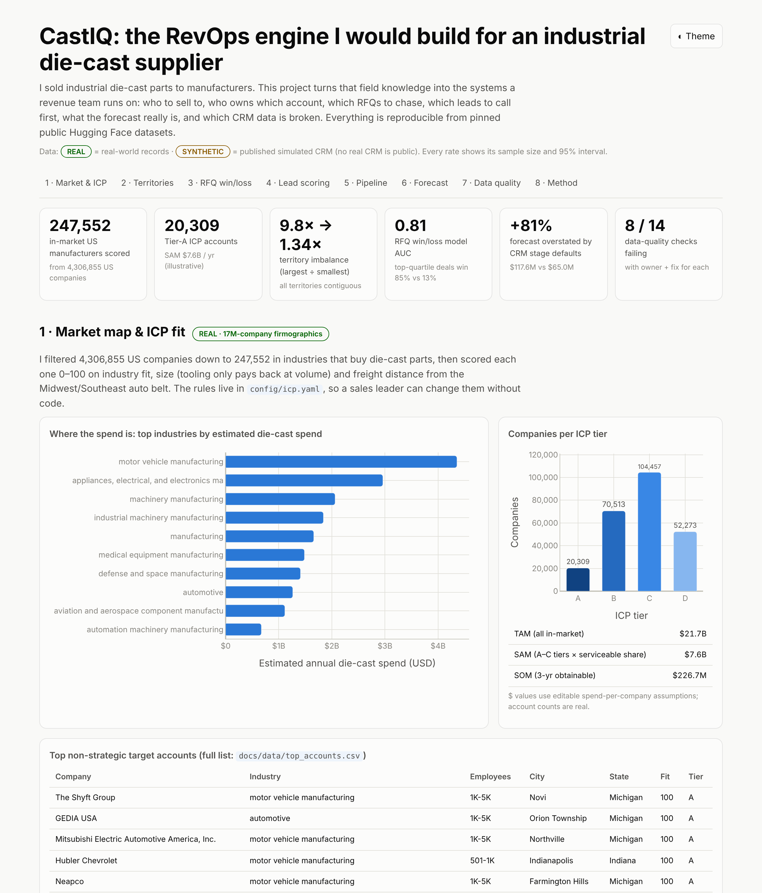

# CastIQ — RevOps analytics for an industrial die-cast supplier

[](../../actions/workflows/ci.yml)
 


**One command turns three public Hugging Face datasets into the systems a revenue team runs on:**
market sizing, ICP scoring, territory design, account routing, RFQ win/loss analysis, lead scoring,
pipeline health, forecasting, and a CRM data-quality report — in a static dashboard anyone can open.

I come from industrial die-cast sales: selling cast metal parts to manufacturers. This project is what I would
build on day one as the RevOps / GTM engineer for a supplier like the ones I sold for.



**[Open the live dashboard →](https://pilsonwang.github.io/castiq/)** · [Case study](docs/CASE_STUDY.md) · [Architecture](docs/ARCHITECTURE.md) · [Data sources](docs/DATA_SOURCES.md)

## Results in 60 seconds

| Question a CRO asks | Answer from this project |
|---|---|
| How big is our market? | **247,552** in-market US manufacturers (of 4,306,855 US companies); **20,309** Tier-A. Illustrative SAM **$7.6B/yr**. |
| Are territories fair? | Geography-only territories were **9.8×** apart in potential. Rebalanced, contiguous territories: **1.34×** (CV 0.51 → 0.10). |
| Which RFQs should we quote? | A qualification model on **448 real B2B deals** reaches AUC **0.81 ± 0.04**. Top-quartile deals win **85%**, bottom quartile **13%**. |
| Which leads first? | Tier-A leads convert at **33%** vs **18%** for tier D (test AUC 0.606). A documented leakage trap (+0.035 AUC) was caught and removed. |
| What will we book? | CRM default stage probabilities say **$117.6M**. Calibrated model: **$65.0M** (commit $62.3M – best case $67.7M). Defaults overstate by **81%**. |
| Is one rep better? | Rep win rates span 45%–50%, but a chi-square test gives p = 1.00: **no evidence** of a real difference. |
| Can we trust the CRM? | **8 of 14** automated checks fail — e.g. 78% of contacts have a seniority that contradicts their title, 10,755 duplicate company websites. |

## Run it

```bash
python -m venv .venv && source .venv/bin/activate
pip install -e ".[dev]"
castiq run-all          # download pinned data (~630 MB, cached) → build warehouse → analyze → dashboard
open docs/index.html
```

Other commands: `castiq ingest`, `castiq build`, `castiq analyze`, `make test`, `make lint`.

## What is inside

| Area | File | What it shows |
|---|---|---|
| Data ingest | `src/castiq/ingest.py` | Pinned HF revisions, SHA-256 manifest, DuckDB streaming of a 17M-row file |
| Warehouse | `src/castiq/sql/*.sql` | dbt-style staging → intermediate → marts in DuckDB |
| ICP & market | `src/castiq/icp.py`, `config/icp.yaml` | Transparent fit score a sales leader can edit; TAM/SAM/SOM |
| Territories & routing | `src/castiq/routing.py` | Balanced, contiguous territory design; auditable first-match routing rules |
| RFQ win/loss | `src/castiq/win_loss.py` | Driver analysis with confidence intervals → qualification checklist |
| Lead scoring | `src/castiq/lead_score.py` | Model selection on validation, one-time test, bootstrap CI, leakage audit, points scorecard |
| Pipeline | `src/castiq/pipeline.py` | Funnel, segment win rates with Wilson intervals, stalled deals, rep significance test |
| Forecast | `src/castiq/forecast.py` | Calibrated win probability, Monte Carlo commit/best case vs CRM defaults |
| Data quality | `src/castiq/quality.py` | 14 hygiene checks with severity, owner and reason |
| Report & docs | `src/castiq/report.py`, `src/castiq/docs.py` | Static dashboard + generated docs (numbers never drift) |

## Honest limits

- The CRM dataset is **synthetic** (no real CRM is public). The firmographics and the win/loss deals are **real**.
- Dollar market sizes use **editable spend assumptions** in `config/icp.yaml`; account counts are real.
- Close dates are hidden in the CRM source, so the forecast is validated by out-of-fold calibration, not by a quarterly back-test.

## License

Code: MIT. Data: each dataset keeps its own license (see [DATA_SOURCES](docs/DATA_SOURCES.md)).
