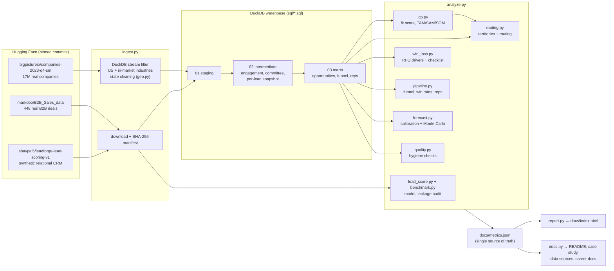

# Architecture

## Design decisions

| Decision | Why |
|---|---|
| **DuckDB** as the warehouse | Streams a 629 MB gzip CSV in ~20 s on a laptop; the SQL ports to Snowflake / BigQuery with small changes. |
| **dbt-style SQL layers** without dbt | Staging → intermediate → marts is the pattern a data team expects; a 40-line runner avoids a heavy dependency. |
| **Pinned Hugging Face revisions + SHA-256 manifest** | Every number can be traced to a byte-identical input. |
| **Config in YAML** (`config/*.yaml`) | Sales leaders edit ICP weights, stage probabilities and territory count without touching code. |
| **One metrics file feeds every output** | The dashboard, README, case study and resume bullets can never disagree. |
| **Intervals on every rate** | Small samples lie. Wilson intervals, bootstrap AUC intervals and a chi-square test stop false conclusions. |
| **Static HTML dashboard** | Opens anywhere (GitHub Pages, email attachment, offline). No server, no login. |
| **Leakage audit inside the model code** | The leaked-feature model is trained on purpose so the inflation is measured, not guessed. |

## Data model (marts)

| Table | Grain | Key columns |
|---|---|---|
| `stg_companies` | company | industry, size_band, state (cleaned), state_raw |
| `mart_opportunities` | opportunity | stage, acv, is_won, account firmographics, contact persona, engagement counts, buyer roles engaged, days_since_engaged |
| `mart_funnel` | funnel step | step, n |
| `mart_rep_scorecard` | rep | opportunities, won, won_acv, open_pipeline_acv |
| `stg_deals` | real B2B deal | qualification fields, is_won |

## Tests

`tests/` holds unit tests for each module (small hand-made fixtures, no network) and one end-to-end test that runs
ingest-free warehouse build → analysis → dashboard → docs on a synthetic fixture project. Set `CASTIQ_NETWORK_TESTS=1`
to also run the test that downloads from Hugging Face and checks the pinned file hashes.
